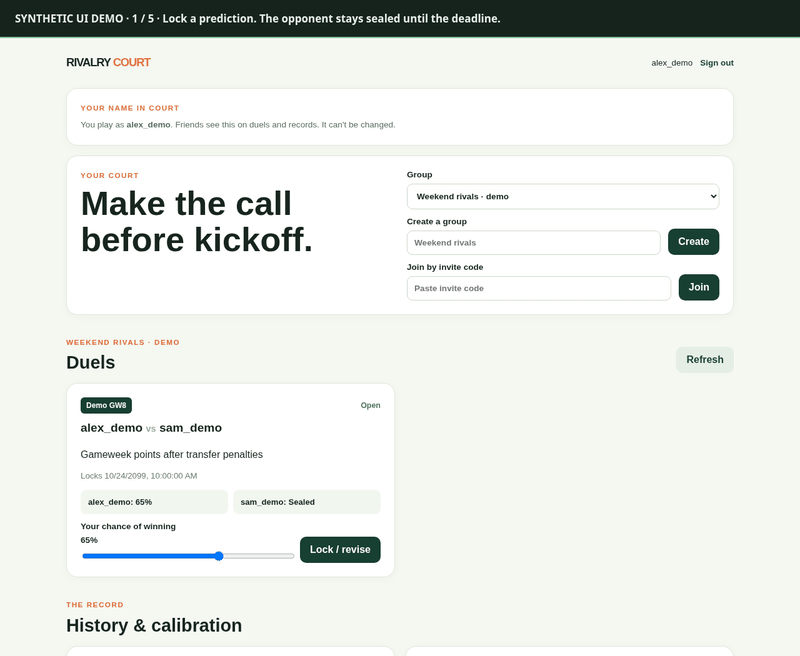
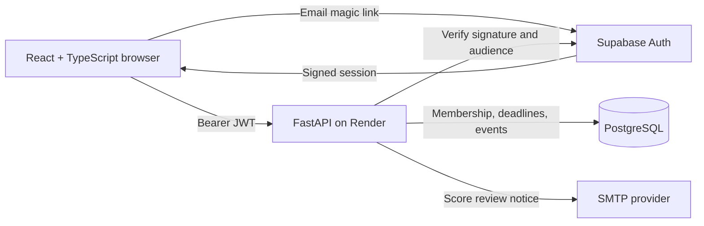
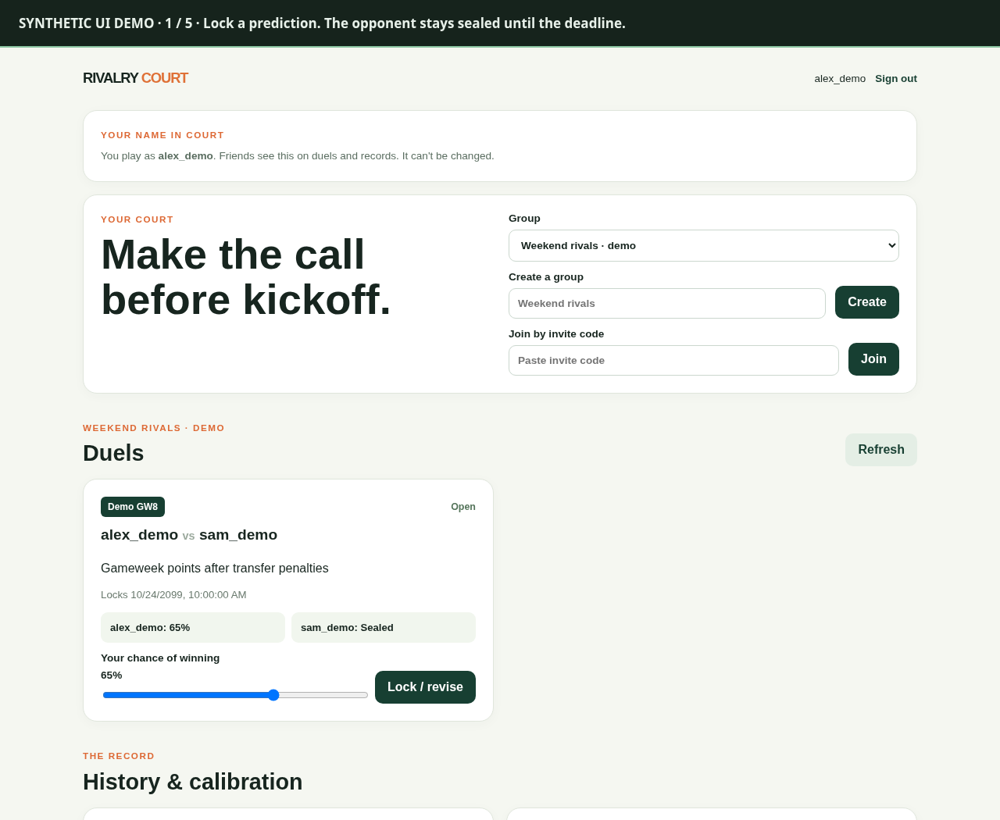
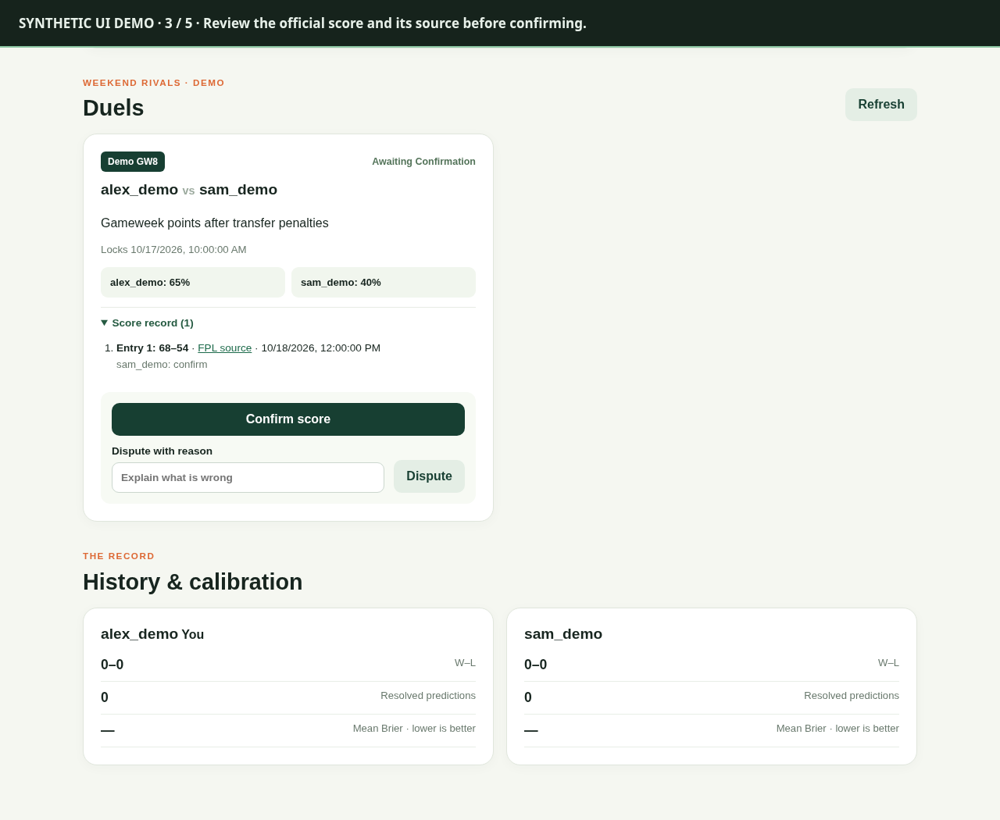
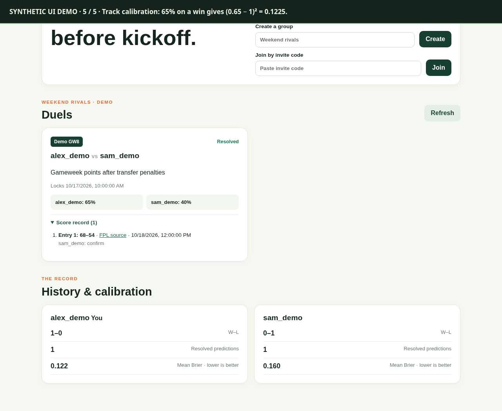

# Rivalry Court

**A full-stack FPL companion for predictions you can revisit after the deadline.**

[Try the deployed app](https://rivalry-court-web.onrender.com) · [60-second captioned walkthrough](../assets/rivalry-court/walkthrough.mp4) · [Mobile screenshot](../assets/rivalry-court/mobile.png)

The free API may take about a minute to wake. Live sign-in uses an email magic link, and groups require an invite. Source is private; this page lets you inspect the product and engineering choices without an account.

**Media provenance:** actual React UI rendered locally on October 18, 2026, with synthetic player names, scores, auth, and API responses. The MP4 is a captioned screenshot sequence, not real gameplay. It demonstrates interface states; it does not prove backend correctness, production email delivery, or user adoption. The mobile capture is a 390px browser viewport, not a physical-phone test.

## Problem and scope

Friends make confident FPL predictions before kickoff, then remember them differently afterward. Rivalry Court records each person's probability before the official deadline, reveals the predictions afterward, and preserves score corrections. It measures calibration with Brier scores rather than treating every confident win as good forecasting.

The first release covers private groups, two fixed head-to-head claim types, manual official score entry, participant confirmation/dispute, and history. Automatic FPL data import, gameweek counterfactuals, and AI features are later work.

## My contribution

I built Rivalry Court with AI assistance: React/TypeScript interface, FastAPI API, PostgreSQL event model and migrations, authentication integration, automated tests, and deployment configuration. AI assistance is part of the development process; the code, deployment, and decisions need to be understood and maintained by me.

## Architecture

## Decisions and tradeoffs

| Decision | Why | Cost / limit |
| --- | --- | --- |
| Append-only predictions and score revisions | Preserve what people submitted and what changed | More complex reads; database administrators remain trusted |
| Server-enforced UTC deadlines and membership | Browser controls alone cannot protect hidden predictions | Boundary and access tests are essential |
| Manual finalized FPL scores with source links | Keep the first release independent of an unofficial data feed | Admin accuracy and timely entry are required |
| Review clock starts after successful score notice | Avoid expiring a review period after a failed send | SMTP acceptance is not inbox delivery; partial sends can duplicate on retry |
| Resolve expired review windows when read | Keep the first release small | No worker promising an update at the exact 72-hour instant |

## Inspect the interface

### Before the deadline

Each person can revise their own probability; the opponent's stays sealed.

### Review the score

Participants can inspect the official source and confirm or dispute the score. Corrections preserve earlier entries.

### After resolution

The example 65% winning prediction has Brier score `(0.65 − 1)² = 0.1225`. The interface rounds for display. One example is not evidence of predictive skill.

## Evidence and remaining work

- Repository notes record a real two-user production sign-in, group join, duel creation, and prediction lock on October 8–9, 2026. This session did not repeat those live actions.
- Local verification: 24 API tests passed (two PostgreSQL-only tests skipped), 14 frontend tests passed, API/web lint and frontend build passed. The browser capture reported no page errors or horizontal overflow at 390px. Tests and synthetic screenshots are separate from production validation.
- Production score-notice receipt, dispute/correction/void/tie/72-hour flows, a physical-phone review, and multi-gameweek use remain unverified.
- The next pilot is 2–4 consenting friends over three gameweeks: record task completion, observed confusion, notice delivery, return use, fixes, and retest outcomes. No new participants were recruited and no pilot outcomes are claimed here.

The next evidence milestone is a completed real gameweek and an anonymized account of what users found difficult and what changed.
