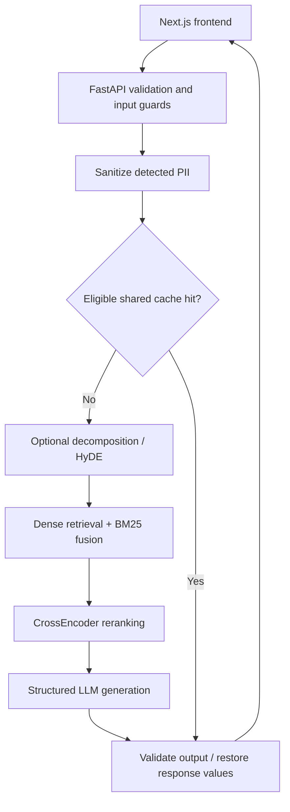

# SecureRAG

**An experimental financial document question-answering system with an inspectable evaluation path.**

[Source and setup](https://github.com/emanster2006-ai/Project-w-emanster) · [Benchmark protocol](https://github.com/emanster2006-ai/Project-w-emanster/blob/main/docs/BENCHMARKS.md)

## Problem and ownership

Financial questions often require finding the right filing evidence and checking that an answer follows from it. SecureRAG combines evidence retrieval with structured generation and experimental security controls. The current ingestion path uses FinanceBench evidence snippets; it should not be described as a validated full-filing research service.

This is a team project. **My focus is the Next.js frontend, API integration, CI/CD, API hardening, and the retrieval benchmark and improvements. Erik built the original scaffold, evaluation framework, and first retrieval pipeline.** These descriptions distinguish project architecture from individual authorship.

## Architecture

This diagram describes implemented components. It is not proof of retrieval quality or resistance to arbitrary attacks.

## Engineering choices

| Choice | Purpose | What needs evidence |
| --- | --- | --- |
| Keep gold questions and answers out of chunk metadata | Reduce evaluation leakage | Fresh evidence-only corpus and provenance checks |
| Sanitize before retrieval/generation; isolate PII-bearing cache responses | Make privacy boundaries explicit | Detection quality and adversarial testing beyond substituted route tests |
| Compare five retrieval variants on identical questions | Test whether added complexity helps | Live provider-backed measurements and failure review |
| Persist per-attempt artifacts and failed queries | Make comparisons auditable | Full run completion, manual inspection, and source attribution |

## Benchmark status

**Retrieval is measured.** A no-API-key benchmark checks, for all 150 FinanceBench questions, whether a chunk from the right evidence passage reaches the reranked top 5. It rose from 70.0% to 94.0% (top 8: 96.0%) with company and fiscal-period chunk headers and fiscal-year-aware reranking; larger rerankers, a bigger candidate pool, HyDE, and year-filtered search were measured and rejected ([details](https://github.com/emanster2006-ai/Project-w-emanster/blob/main/docs/BENCHMARKS.md)). A hit means the right passage was retrieved, not necessarily the chunk holding the figure.

**No end-to-end answer accuracy, cost, or end-user latency result is claimed.** The free model tier's token limits stopped a full answer-quality run.

The improved runner prepares auditable comparisons of dense-only, dense with reranking, hybrid-only, hybrid with reranking, and HyDE with hybrid/reranking. It records the selected questions, seed, corpus/dataset hashes, Git revision, package/model names, answers, retrieved context, judge explanations, failures, and confidence intervals.

Judge scores are proxies. Timings include retrieval, generation, and judging; they are not API response times. Token usage and cost remain unavailable from the current wrappers. The publishable milestone is a completed reproducible run with manually reviewed failures, not a higher-looking placeholder score.

## What a reviewer can inspect now

CI runs 106 backend unit/integration tests, 12 frontend unit tests, 3 Playwright browser tests, lint/format checks, and a dependency audit. The README shows [real answers from the local stack](https://github.com/emanster2006-ai/Project-w-emanster#demo), including one known miss.

The public repository contains the Next.js frontend, API routes, deterministic contract tests, chunker and Presidio unit tests, CI, and setup instructions. The README identifies ownership and separates implementation from measured results. Deployment of the complete hosted pipeline remains unverified.
