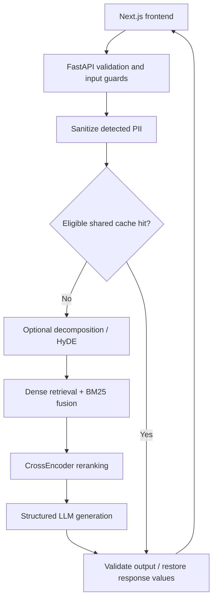

# SecureRAG

**An experimental financial document question-answering system with an inspectable evaluation path.**

[Source and setup](https://github.com/emanster2006-ai/Project-w-emanster) · [Benchmark protocol](https://github.com/emanster2006-ai/Project-w-emanster/blob/main/docs/BENCHMARKS.md)

## Problem and ownership

Financial questions often require finding the right filing evidence and checking that an answer follows from it. SecureRAG combines evidence retrieval with structured generation and experimental security controls. The current ingestion path uses FinanceBench evidence snippets; it should not be described as a validated full-filing research service.

This is a team project. **My focus is the frontend, API integration, deployment work, and CI/CD. Erik focuses on retrieval, evaluation, and ML.** These descriptions distinguish project architecture from individual authorship.

## Architecture

This diagram describes implemented components. It is not proof of retrieval quality or resistance to arbitrary attacks.

## Engineering choices

| Choice | Purpose | What needs evidence |
| --- | --- | --- |
| Keep gold questions and answers out of chunk metadata | Reduce evaluation leakage | Fresh evidence-only corpus and provenance checks |
| Sanitize before retrieval/generation; isolate PII-bearing cache responses | Make privacy boundaries explicit | Detection quality and adversarial testing beyond substituted route tests |
| Compare five retrieval variants on identical questions | Test whether added complexity helps | Live provider-backed measurements and failure review |
| Persist per-attempt artifacts and failed queries | Make comparisons auditable | Full run completion, manual inspection, and source attribution |

## Benchmark status

**No comparative improvement, financial accuracy, cost, or end-user latency result is claimed.** Provider keys were unavailable in the portfolio enhancement environment, so there was no live model run.

The improved runner prepares auditable comparisons of dense-only, dense with reranking, hybrid-only, hybrid with reranking, and HyDE with hybrid/reranking. It records the selected questions, seed, corpus/dataset hashes, Git revision, package/model names, answers, retrieved context, judge explanations, failures, and confidence intervals.

Judge scores are proxies. Timings include retrieval, generation, and judging; they are not API response times. Token usage and cost remain unavailable from the current wrappers. The publishable milestone is a completed reproducible run with manually reviewed failures, not a higher-looking placeholder score.

## What a reviewer can inspect now

Local backend verification passed all 44 unit/integration tests, including the benchmark artifact checks. Python lint/format checks passed. No live provider comparison was run.

The public repository contains the Next.js frontend, API routes, deterministic contract tests, chunker and Presidio unit tests, CI, and setup instructions. The README identifies ownership and separates implementation from measured results. Deployment of the complete hosted pipeline remains unverified.
